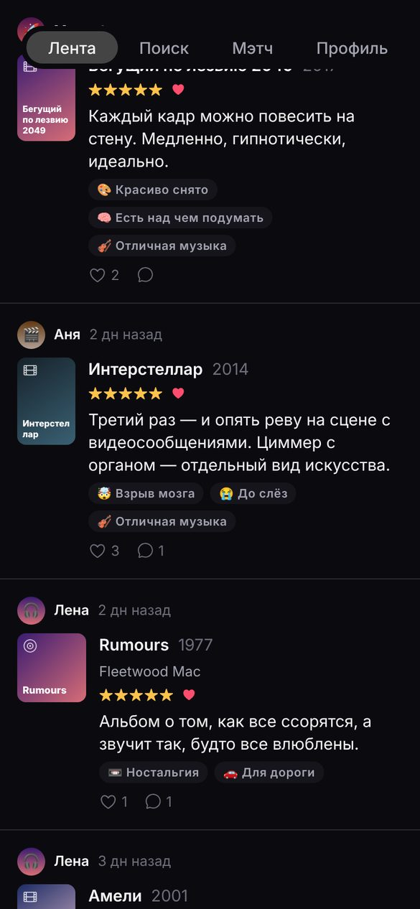
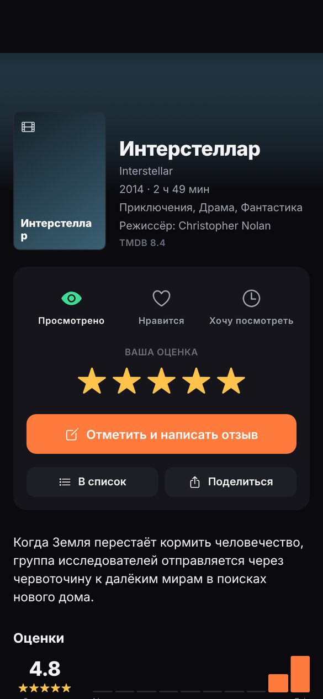
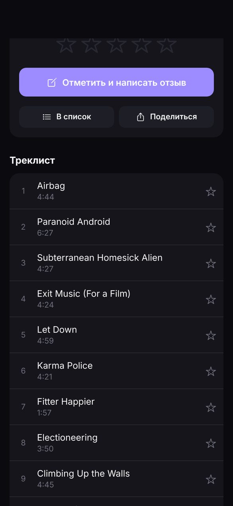
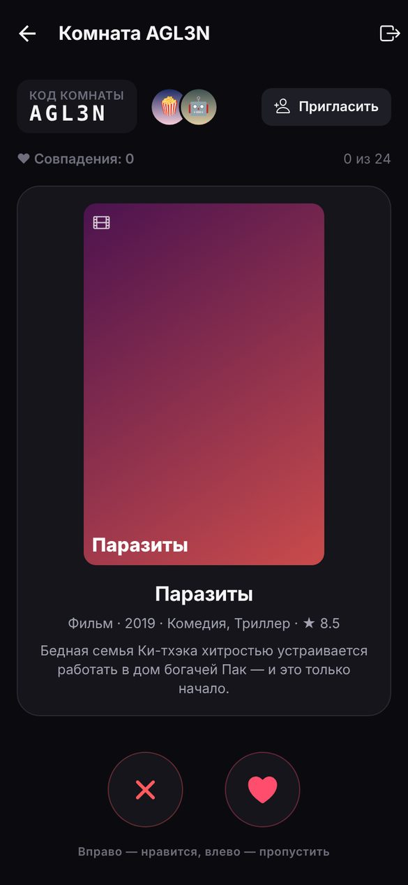
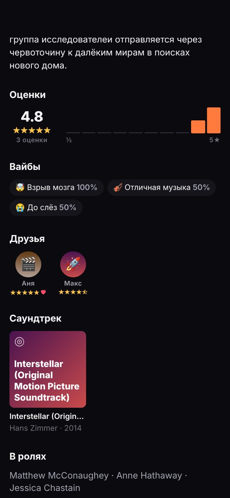
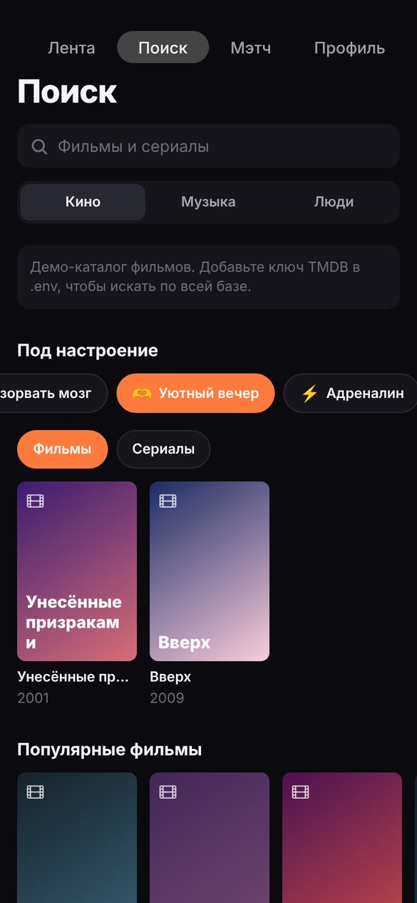
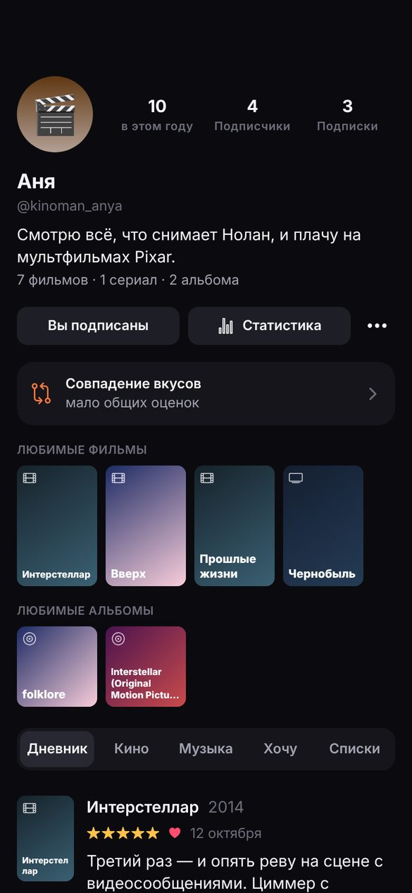

# Copione

**Кино, сериалы и музыка в одном дневнике.** Оценивайте, пишите рецензии, ведите прогресс по сериалам, слушайте превью треков, делитесь карточками в сторис и выбирайте фильм на вечер вместе с друзьями.

Приложение для iPhone (и Android — тот же код) на Expo / React Native. Работает сразу, без ключей и серверов (демо-режим), а для настоящего запуска подключаются бесплатные TMDB и Supabase.

| Лента | Фильм | Альбом | Мэтч |
|---|---|---|---|
|  |  |  |  |

| Сообщество | Поиск | Профиль |
|---|---|---|
|  |  |  |

<sub>Скриншоты сделаны в демо-режиме, поэтому вместо постеров цветные заглушки. С ключом TMDB и в Apple Music будут настоящие обложки.</sub>

## Чем отличается от Letterboxd

| Фишка | Что это |
|---|---|
| 🎬🎧 **Кино + сериалы + музыка** | Фильмы, сериалы, альбомы, EP, синглы и отдельные треки в одном профиле и одной ленте |
| ⭐ **Оценка каждого трека** | Прямо в треклисте альбома, приложение подсказывает «среднюю по трекам» как оценку альбома |
| 🎻 **Саундтрек фильма** | На странице фильма есть его саундтрек, который можно открыть и оценить как альбом |
| 📺 **Сериалы по-настоящему** | Прогресс по сериям, «Продолжить смотреть» с кнопкой отметки следующей серии, дата новой серии, отзывы о сезонах |
| 💞 **Мэтч** | Комната с кодом: вдвоём или компанией свайпаете общую колоду и получаете «Это мэтч!», когда фильм понравился всем |
| 🧬 **Совпадение вкусов** | Процент совместимости с любым человеком (отдельно кино и музыка), «вы оба любите» и «главные разногласия» |
| 🤯 **Вайбы** | Вместо сухих жанров: «Взрыв мозга», «До слёз», «На репите»… На странице тайтла видно, что почувствовала аудитория |
| 🙈 **Слепая оценка** | Средний рейтинг скрыт, пока вы не оценили сами, чтобы мнение толпы не влияло |
| 🛡 **Умная защита от спойлеров** | Рецензии со спойлерами скрыты, а отзывы о сезонах, которые вы ещё не досмотрели, прячутся автоматически |
| 😂 **Под настроение** | Подборки «Посмеяться», «Поплакать», «Уютный вечер», «Взорвать мозг»… |
| 📸 **Карточки для сторис** | Картинка 9:16 с отзывом или итогами года для Instagram, Telegram и т. д. |
| 📊 **Статистика и цели** | Итоги года, часы, любимые жанры, режиссёры и артисты, цель «N фильмов / альбомов в год». Бесплатно |
| 📥 **Импорт из Letterboxd** | Дневник, оценки, рецензии, просмотренное и «хочу посмотреть» из CSV-экспорта |

Есть и всё базовое: оценки с половинками звёзд, дневник с датами и пересмотрами, рецензии, лайки, комментарии, списки (в том числе нумерованные), «Хочу посмотреть / послушать», любимые фильмы и альбомы в профиле, подписки и лента друзей, поиск людей, 30-секундные превью треков, «где посмотреть» (стриминги), экспорт дневника в CSV, русский и английский интерфейс.

Для App Store всё нужное уже есть: жалобы на контент, блокировка пользователей, правила сообщества при регистрации, удаление аккаунта внутри приложения.

## Быстрый старт: 5 минут, без ключей

Понадобятся компьютер (Windows, macOS или Linux; Mac **не нужен**), [Node.js LTS](https://nodejs.org) и iPhone с приложением **Expo Go** из App Store.

```bash
git clone https://github.com/artyomvorobiov/copione.git
cd copione
npm install
npx expo start
```

Наведите камеру iPhone на QR-код в терминале, и приложение откроется в Expo Go. Это демо-режим: данные хранятся на телефоне, фильмы берутся из встроенного каталога, а демо-сообщество (Аня, Макс, Лена…) уже оставило отзывы. Музыка на телефоне сразу настоящая, из Apple Music.

Подробно по шагам (ключ TMDB, Supabase, частые проблемы): **[docs/SETUP.md](docs/SETUP.md)**.

## Режимы работы

| Что настроено в `.env` | Что работает |
|---|---|
| Ничего | Демо: всё на телефоне, демо-каталог фильмов, демо-сообщество, бот в Мэтче |
| `EXPO_PUBLIC_TMDB_KEY` | + весь каталог фильмов и сериалов TMDB с постерами, трейлерами и «где посмотреть» |
| + `EXPO_PUBLIC_SUPABASE_URL` и `EXPO_PUBLIC_SUPABASE_ANON_KEY` | + аккаунты, друзья, лента, комментарии, Мэтч между разными телефонами |

## Публикация в App Store и Google Play

Сборка идёт в облаке через EAS, Mac не нужен. Пошагово, вместе с требованиями Apple: **[docs/PUBLISHING.md](docs/PUBLISHING.md)**.

## Как устроен проект

```
src/
  app/              экраны (Expo Router: файл = экран)
    (tabs)/         вкладки: Лента, Поиск, Мэтч, Профиль
    media/[type]/   страница фильма, сериала, альбома или трека
    log.tsx         «Отметить» / рецензия
    match/[id].tsx  комната Мэтча
    …               профили, списки, статистика, настройки, импорт
  components/       UI-компоненты (постеры, звёзды, карточки, свайп-колода…)
  catalog/          TMDB (кино), iTunes Search API (музыка), демо-каталог
  backend/          Supabase (облако) и LocalBackend (демо на устройстве)
  lib/              логика без UI: совпадение вкусов, статистика, серии, CSV…
  i18n/             русский и английский тексты
  state/            настройки, сессия, плеер превью, уведомления
supabase/schema.sql схема базы: таблицы, права доступа (RLS), функции
tests/supabase/     интеграционные тесты против локального Supabase
docs/               инструкции, скриншоты, шаблон политики конфиденциальности
```

Стек: Expo SDK 57, React Native 0.86, TypeScript, Expo Router (нативные вкладки iOS), TanStack Query, Supabase (Postgres + Auth), expo-audio, expo-image.

## Команды

| Команда | Что делает |
|---|---|
| `npm start` | запуск для Expo Go (`npx expo start -c` сбрасывает кэш после изменения `.env`) |
| `npm test` | юнит-тесты логики и демо-бэкенда |
| `npm run typecheck` | проверка типов TypeScript |
| `npm run lint` | ESLint |
| `npm run test:supabase` | интеграционные тесты облачного бэкенда (нужен Docker, см. [tests/supabase/README.md](tests/supabase/README.md)) |

## Данные и лицензии

- Фильмы и сериалы: [TMDB](https://www.themoviedb.org). *This product uses the TMDB API but is not endorsed or certified by TMDB.* Бесплатно для некоммерческого использования, а для монетизации (реклама, подписка) нужна коммерческая лицензия TMDB.
- Музыка: [Apple iTunes Search API](https://performance-partners.apple.com/search-api), ключ не нужен.
- Стриминговые сервисы: JustWatch (через TMDB).

Ссылки на источники уже есть в «Настройки → О приложении».

Идеи, что делать дальше: [docs/FEATURES.md](docs/FEATURES.md).
